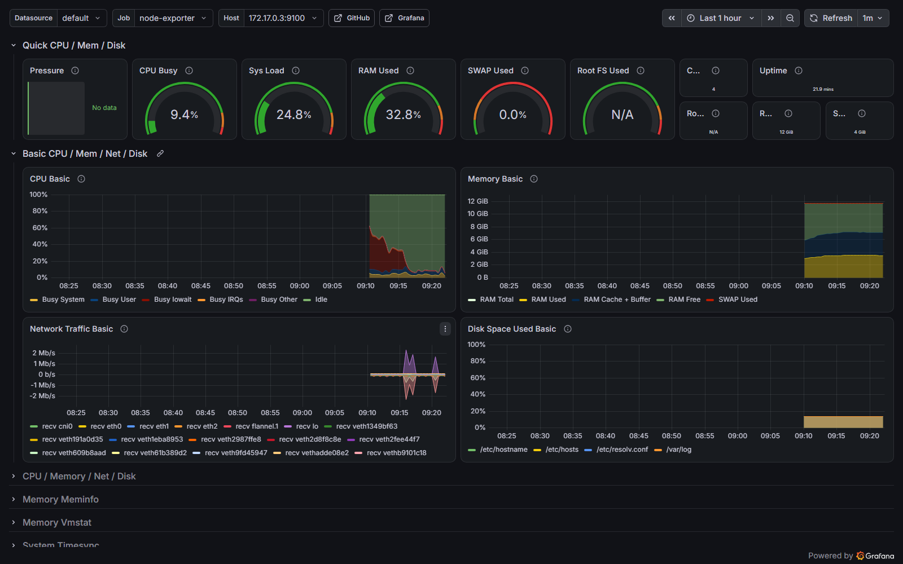
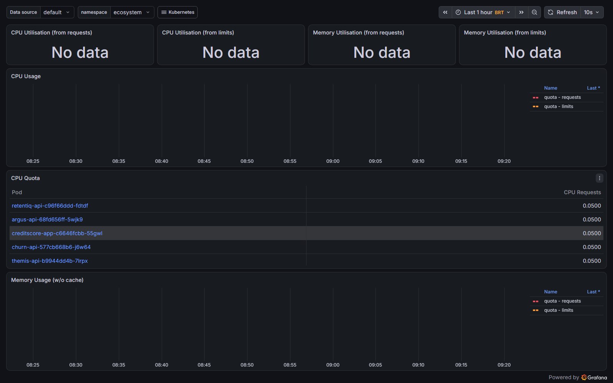
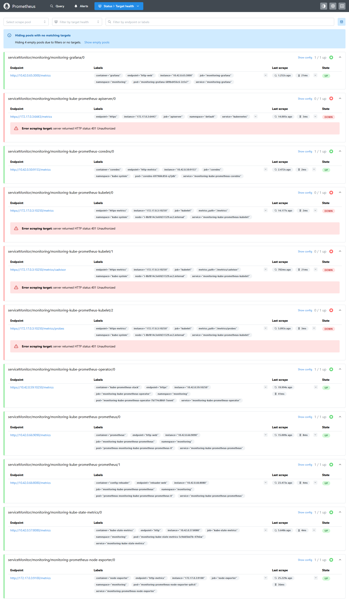
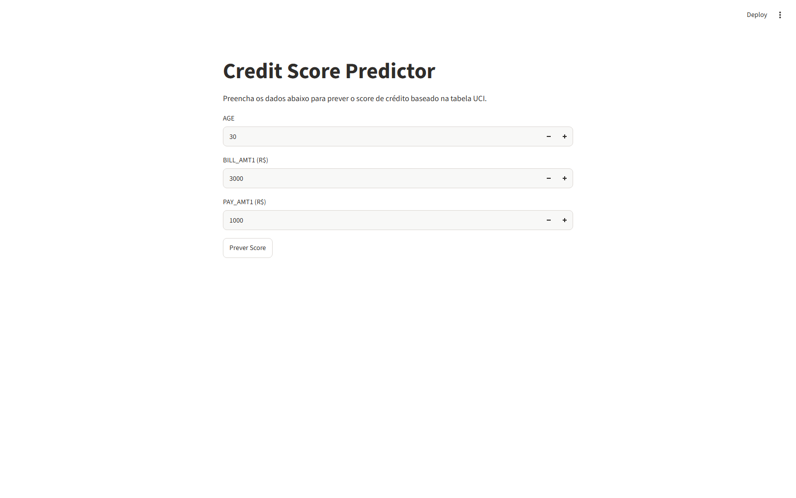
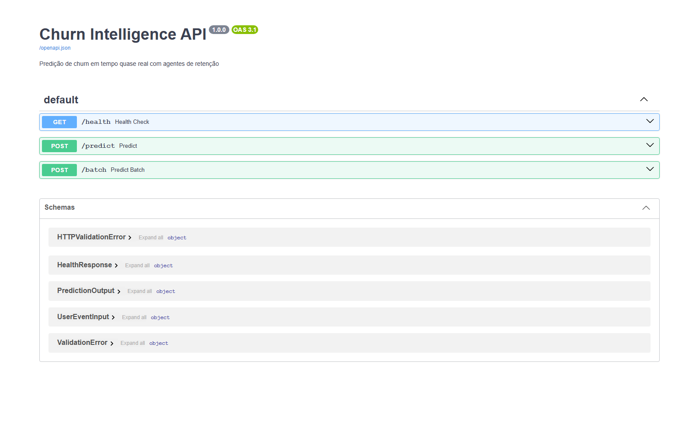

# ☁️ AWS Project — Master do ecossistema Argus: AWS emulada (R$ 0) e AWS real, com MCP, GitOps e contratos

### Terraform · AWS (EKS · ECR · VPC · IAM/OIDC · Lambda · API Gateway · DynamoDB · S3 · WAF · AMP) · floci · Kubernetes (k3s) · ArgoCD · Kustomize · Helm · Prometheus/Grafana · Docker · Python · MCP · GitHub Actions

[](.github/workflows/platform-floci.yml)


 

## Status

🟡 **Em desenvolvimento — perfil `free` (AWS emulada) completo e testado localmente; perfil `real` preparado, nunca executado.**
Verificado em 06/11/2026: 6 stacks Terraform aplicadas no emulador, 6 serviços + 1 job dos repositórios do ecossistema
rodando no EKS emulado, Credit Score serverless (Lambda + DynamoDB) respondendo, `platform/e2e.py` **13/13** (inclui
3 validações de contrato). Ainda não: execução do workflow no GitHub (depende de push), perfis MCP validados, qualquer
recurso na AWS real.

| Área | Estado | Evidência |
|---|---|---|
| IaC (7 stacks, alvo duplo) | ✅ aplicado no floci | `lab.py plan --target free` → "No changes" |
| EKS emulado + GitOps + observabilidade | ✅ | ArgoCD 5/5, kube-prometheus-stack 5/5, `ecosystem` 6 Running + job Completed |
| Comunicação com os repos | ✅ manifesto + contratos | `ecosystem/repos.json`, `tools/repos.py status`, `contracts/*.schema.json` |
| Roles IAM + guardrails | ✅ no floci | stack `06-identity`, [`docs/IAM_ROLES.md`](docs/IAM_ROLES.md) |
| Dados fora da AWS | ✅ local · R2 bloqueado por credencial | `tools/offload.py` (S3 + DynamoDB → `D:rgus-data`) |
| Perfil `real` (AWS) | ⏳ preparado | `envs/real/` — exige aprovação e guardrails do plano v0.2 |
| MCP | 🟡 configurado, não testado | `mcp/free.mcp.json`, `mcp/real.mcp.json` |
| CI no GitHub | ⏳ escrito, não executado | `.github/workflows/platform-floci.yml` |

---

## Descrição / Contexto

Repositório **Master** (camada de orquestração) do ecossistema de portfólio Argus. Ele não reescreve os produtos: integra
os repositórios existentes por **contratos versionados**, sobe a infraestrutura AWS do curso **DevOps na Nuvem** como
código próprio e roda tudo em dois perfis com o **mesmo código**:

- **`free`** — AWS emulada localmente pelo [floci](https://github.com/floci-io/floci) (MIT): sem conta, sem custo. EKS vira
  um k3s real, ECR é um registry real, Lambda roda em containers reais.
- **`real`** — AWS de verdade, em sessões curtas e aprovadas, respeitando o Free Plan (sem Organizations/Control Tower/
  Managed Grafana, teardown no mesmo dia).

O agente (Claude Code) opera a plataforma via **MCP** (Terraform, AWS API, EKS, documentação AWS), como no workshop.

---

## 🧭 Origem do Projeto

1. Curso comprado (DevOps na Nuvem: workshop de 2 dias + aulas de observabilidade). As 9 aulas (11h57) foram transcritas
   e lidas por OCR com `tools/course_kb` (base privada fora do git) e cruzadas com os repositórios.
2. Conclusões que definiram o projeto: (a) o Free Plan fecha a conta e apaga os dados ao expirar — persistência fica fora
   da AWS; (b) Managed Grafana + Identity Center ativa Organizations e converte a conta em paga; (c) quase todo o curso roda
   num emulador AWS local — o floci (único emulador no pool; LocalStack Community foi descontinuado em mar/2026).
3. Plano em fases com gates de evidência: `docs/plans/` (v0.1 do GPT → v0.2 → plano de ação v1 → plano de 2 dias).

---

## 🎯 Objetivo

- Subir VPC → EKS → ECR → OIDC → WAF → AMP com Terraform próprio, aplicável no floci e na AWS sem duplicar código.
- Implantar os produtos do ecossistema (Argus, RetentIQ, ThemisAI, OmniMind, Churn, RiskCredit, Credit Score) no EKS por GitOps.
- Integrar os repositórios por manifesto fixado (commit) e contratos JSON Schema verificados no teste de ponta a ponta.
- Operar a plataforma por MCP; manter R$ 0 no perfil `free` e custo controlado no `real`.

---

## 🔬 Linha de Desenvolvimento

Platform engineering (IaC multi-stack, remote state com `use_lockfile`), Kubernetes (probes, PDB, HPA-ready, Kustomize,
ArgoCD), FinOps (alvo duplo, guardrails), serverless (Lambda empacotada ≤ 50 MB), MLOps (job de treino → artefato com
manifesto sha256 → serving), contratos de dados, agentes com MCP.

---

## 🏗️ Arquitetura

```text
                      Claude Code ──MCP──► terraform · AWS MCP Server · aws-api · eks   (mcp/*.mcp.json)
                           │
AWS Project (Master) ──────┼── platform/lab.py ──► Terraform 00→05 ──► floci (free) | AWS (real)
  ├─ ecosystem/repos.json  │                         backend S3 · VPC · EKS+ECR · OIDC · WAF · AMP
  ├─ contracts/*.schema    │                                     │
  ├─ repos/enterprise ◄────┘ (submodule: módulos networking/iam/eks)
  └─ gitops/ ──kubectl/ArgoCD──► EKS (k3s) ─┬─ argus-api ─ retentiq-api ─ themis-api
                                            ├─ omnimind-api ─ churn-api ─ creditscore-app
                                            ├─ job riskcredit-train ──► S3 (model_manifest.v1)
                                            └─ Prometheus + Grafana OSS
Credit Score serverless: API Gateway v2 ─► Lambda (modelo v3) ─► DynamoDB   (Terraform do próprio repo)
```

| Módulo | Função | Teste |
|---|---|---|
| `platform/terraform/00…05` | stacks com `var.aws_endpoint` (null = AWS real) | `lab.py up/plan/down`, CI |
| `repos/enterprise-automation` | módulos `networking`, `iam`, `eks` (submodule) | `validate` + apply no floci |
| `gitops/gen.py` + `apps.json` | manifests Kustomize (base + overlays `floci`/`aws`) e ApplicationSet | `kubectl kustomize`, deploy |
| `platform/images/*` | Dockerfiles enxutos por app (contexto = clone fixado) | `images/smoke.py` (6/6) |
| `contracts/` | `model_manifest.v1`, `scoring_result.v1`, `customer_activity.v1` | `e2e.py` |
| `tools/repos.py` | status/sync/pin dos repositórios | `repos.py status` |

---

## ⚙️ Funcionamento

1. `tools/repos.py sync` materializa cada repositório no commit fixado em `ECO_DIR` (fora do Google Drive).
2. `lab.py floci-up` sobe o emulador; `lab.py up` aplica as 6 stacks em ordem; `lab.py kubeconfig` gera acesso IAM ao EKS.
3. Helm instala ArgoCD e kube-prometheus-stack; `images/build.py` publica as 7 imagens no ECR.
4. `lab.py deploy` aplica `gitops/overlays/floci` e injeta endpoint/segredos de laboratório.
5. `serverless/package_creditscore.py` + Terraform do Credit Score criam a API serverless.
6. `e2e.py` verifica serviços, previsões, artefato de modelo, Lambda, DynamoDB e contratos.

---

## 🧠 Verificação / Modelagem

| Camada | O que prova | Resultado |
|---|---|---|
| Spike do IaC do curso (sem editar) | compatibilidade do emulador | dvn-workshop-maio 4/4 stacks; eks-express-iac 3/6 completas |
| Stacks próprias | IaC aplicável e idempotente | 6/6 aplicadas; `plan` sem mudanças |
| Smoke de imagens | apps sobem isolados | 6/6 HTTP 200 |
| `e2e.py` | integração ponta a ponta + contratos | 13/13 |

Não verificado nesta revisão: workflow no GitHub, perfis MCP, perfil `real`, sincronização ArgoCD a partir do GitHub.

---

## 🧪 Desenvolvimento Experimental

**Achados reais (não plantados)** — detalhes e contornos em [`docs/floci-compat-matrix.md`](docs/floci-compat-matrix.md):
- `kubectl` rejeitado → o webhook do EKS emulado só aceita tokens de access key existente no IAM do floci → `lab.py` cria usuário IAM de lab.
- Lambdas falhavam até numa "hello" → autodetecção do host da Runtime API no Docker Desktop → `FLOCI_SERVICES_LAMBDA_DOCKER_HOST_OVERRIDE`.
- `aws_prometheus_workspace` quebra com provider 6.x (logging não implementado no floci) → AMP automático off no emulador.
- `*.localhost` não resolve no Windows → endpoint `localhost.floci.io` e ECR estilo `path`.
- Zip da Lambda acima de 50 MB (mesmo limite da AWS) → poda de pacotes até 49 MB, testado na imagem oficial da Lambda.

---

## 🛠️ Tecnologias

**Linguagens:** Python, HCL, YAML · **IaC:** Terraform 1.15 (hashicorp/aws ~> 6) · **Kubernetes:** k3s 1.33 (EKS emulado),
Kustomize, Helm, ArgoCD · **Observabilidade:** Prometheus, Grafana OSS, node-exporter · **AWS (emulada/real):** VPC, EKS, ECR,
IAM/OIDC/IRSA, S3, Lambda, API Gateway v2, DynamoDB, Cognito, KMS, Step Functions, WAFv2, AMP · **Emulador:** floci 2.4.0 ·
**Agentes:** Claude Code + MCP.

---

## 📊 Resultados

| Medida | Valor | Origem |
|---|---|---|
| Recursos por stack (floci) | 00: 5 · 01: 23 · 02: 27 · 03: 4 · 04: 1 · 05: log group · 06: 19 | saída do `terraform apply` |
| Verificações ponta a ponta | 13/13 | `platform/e2e.py` (relatório em `platform/.state/e2e-floci.json`, local) |
| Treino RiskCredit no cluster | champion xgboost, ganho de Gini 0,034, 8 artefatos | log do Job |
| Lambda Credit Score | HTTP 200, PD e faixa de risco, gravação no DynamoDB | `e2e.py` |
| Memória do nó emulado | ~3,7 GB usados de 3,5 GB alocáveis (t3.medium emulada) | `kubectl top node` |

Números são do laboratório local; não representam desempenho ou custo em AWS real.

---

## 🖼️ Evidências

Capturadas por `platform/evidence.py` (Playwright headless) em 07/11/2026, perfil `free`.

<p align="center">
  <a href="docs/evidence/grafana-node-exporter-full.png"></a><br>
  <sub>Grafana OSS — dashboard Node Exporter Full (o mesmo da aula 07), métricas reais do nó do EKS emulado</sub>
</p>
<p align="center">
  <a href="docs/evidence/grafana-k8s-namespace-ecosystem.png"></a>
  <a href="docs/evidence/prometheus-targets.png"></a><br>
  <sub>Pods do namespace <code>ecosystem</code> (requests via kube-state-metrics) · alvos do Prometheus (kubelet/apiserver em 401 — ver Limitações)</sub>
</p>
<p align="center">
  <a href="docs/evidence/creditscore-streamlit.png"></a>
  <a href="docs/evidence/churn-api-swagger.png"></a><br>
  <sub>Front Streamlit do Credit Score e Swagger da API de churn, servidos pelo cluster</sub>
</p>

Outras: `docs/evidence/grafana-k8s-cluster-compute.png`, `docs/evidence/argocd-applications.png` (ArgoCD instalado,
sem Applications até o push do repositório).

---

## 🚀 Aplicações

Laboratório de platform engineering sem custo; demonstração de portfólio (IaC, Kubernetes, GitOps, serverless, MLOps);
ensaio seguro antes de sessões curtas na AWS real.

---

## 🔭 Visão de Longo Prazo

```text
perfil free completo ─► CI verde no GitHub ─► MCP validado ─► sessão real curta (rede) ─► sessão real EKS+GitOps
                                                     ↓
                           eventos RetentIQ→Argus (customer_activity.v1) ─► Lakehouse/ML do plano v0.1
```

---

## 🗺️ Roadmap

- **F0 — Extração do curso** ✅ Concluída — `tools/course_kb`, 9 aulas.
- **F1 — Emulador + spike** ✅ Concluída — matriz de compatibilidade.
- **F2 — Stacks próprias de alvo duplo** ✅ Concluída — 6/6 no floci.
- **F3 — EKS + GitOps + observabilidade** ✅ Concluída — apps e plataforma no cluster.
- **F4 — Serverless Credit Score** ✅ Concluída — Lambda + DynamoDB.
- **F5 — Contratos e manifesto dos repos** 🟡 Parcial — 3 contratos; `customer_activity.v1` sem fluxo produtor→consumidor.
- **F6 — CI no GitHub e MCP** ⏳ Planejada — depende de push e aprovação.
- **F7 — Sessões na AWS real** ⏳ Planejada — `envs/real/`.

---

## 🕓 Histórico e Mudanças

| Versão | Data | O que mudou |
|---|---|---|
| v0.1.0 | 2026-11-06 | Master criado: plataforma (movida do Enterprise), perfis `free`/`real`, manifesto dos repos, contratos, MCP, e2e 13/13 |
| v0.2.0 | 2026-11-07 | Stack `06-identity` (deployer com MFA, MCP somente leitura, `free-plan-guard`, budgets sem créditos, Pod Identity por app — 19 recursos no floci), `tools/offload.py` (dados fora da AWS), evidências visuais, runbook da AWS real |

Histórico de decisões: [`docs/plans/`](docs/plans/).

---

## 🔮 Próximos Passos

**Concluído nesta versão:** perfil `free` completo, contratos validados, manifesto dos repos, Enterprise como biblioteca de módulos.
**Dependem de decisão/terceiros:** criar o repo GitHub e enviar (push via `@devops`); ativar e validar MCP; autorizar sessões na AWS real.
**Próximos técnicos:** fluxo `customer_activity.v1` RetentIQ → fila → Argus; ArgoCD sincronizando do GitHub; OmniMind com LLM gratuito
(Ollama) para o `/ask`; submodules do curso no hub `Projetos_Pessoais`.

---

## ▶️ Como rodar localmente

Pré-requisitos: Docker Desktop (VM com ≥ 4 CPU / 12 GB), Terraform ≥ 1.10, AWS CLI v2, kubectl, Helm, Python 3.10+.
```bash
git clone --recurse-submodules <este repo>
python tools/repos.py sync            # repositórios do ecossistema no commit fixado
python platform/lab.py floci-up       # emulador
python platform/lab.py up             # 6 stacks (perfil free)
python platform/lab.py kubeconfig
# ArgoCD e monitoramento: ver platform/README.md (Helm com "-f -" por causa de vírgulas em caminhos)
python platform/images/build.py && python platform/lab.py deploy
python platform/e2e.py
python platform/lab.py down && python platform/lab.py floci-down
```
| Ambiente | Situação |
|---|---|
| Windows 11 + Docker Desktop (WSL2) | verificado nesta revisão |
| GitHub Actions (ubuntu-24.04) | workflow escrito, não executado |

---

## 📁 Estrutura do repositório

```text
AWS Project/
├── platform/        # lab.py, e2e.py, floci/, terraform/ (00–05, _shared), k8s/, images/, serverless/
├── gitops/          # apps.json + gen.py → apps/<app>/{base,overlays/floci,overlays/aws}, ApplicationSet
├── ecosystem/       # repos.json — manifesto de comunicação com os repositórios
├── contracts/       # JSON Schemas entre repos + validate.py
├── envs/            # free (floci) e real (AWS)
├── mcp/             # perfis MCP free/real
├── repos/           # enterprise-automation (submodule: módulos Terraform)
├── tools/           # repos.py, mcp_profile.py, offload.py (dados fora da AWS), course_kb/ (extração de videoaulas)
└── docs/            # floci-compat-matrix.md, plans/
```
Não versionado: `_private/` (conversa e handoff originais), `platform/.state` e `platform/.kube` (state local, kubeconfig
com chave IAM do emulador, senha do Grafana), `.mcp.json`, base de conhecimento do curso (material pago, fica em `Q:`).

---

## 📚 Documentação

| Documento | Conteúdo |
|---|---|
| [`platform/README.md`](platform/README.md) | passo a passo do laboratório |
| [`docs/floci-compat-matrix.md`](docs/floci-compat-matrix.md) | compatibilidade do emulador e contornos |
| [`envs/free/README.md`](envs/free/README.md) · [`envs/real/README.md`](envs/real/README.md) | perfis |
| [`mcp/README.md`](mcp/README.md) | servidores MCP e ativação |
| [`docs/IAM_ROLES.md`](docs/IAM_ROLES.md) | todas as roles/políticas (curso + plano), quem usa, permissões, stack |
| [`docs/AWS_REAL_MCP_RUNBOOK.md`](docs/AWS_REAL_MCP_RUNBOOK.md) | sessões na AWS real via MCP, custos, e o que acontece quando os créditos acabam |
| [`docs/plans/`](docs/plans/) | planos v0.1 → v0.2 → ação v1 → 2 dias |
| [`tools/course_kb/README.md`](tools/course_kb/README.md) | extração de conhecimento de videoaulas |

---

## ⚠️ Limitações

- Emulador ≠ AWS: sem roteamento real de VPC/NAT, sem filtragem do WAF, AMP sem ingestão, sem Managed Grafana, Karpenter
  e SageMaker Model Package Group; add-ons EKS restritos a 4. Resultados aqui são **FLOCI_LOCAL**.
- OmniMind sobe com chave de LLM fictícia: `/ask` só responde com chave real ou endpoint compatível.
- Nó emulado no limite de memória; o node-exporter roda sem montar o rootfs do host.
- Prometheus recebe **401** do kubelet (cAdvisor) e do apiserver no EKS emulado: painéis de uso de CPU/memória por pod
  ficam vazios (métricas de nó, kube-state-metrics, CoreDNS, Grafana e Prometheus funcionam). Próximo passo: investigar a
  autenticação de tokens de ServiceAccount do k3s configurado pelo floci.
- Roles de workload (Pod Identity) já existem, mas os apps ainda usam credencial estática do emulador (`docs/IAM_ROLES.md`).
- O submodule `repos/enterprise-automation` aponta para commit ainda não enviado ao GitHub.

---

## Status

🟡 Em desenvolvimento — perfil `free` completo e testado localmente (e2e 13/13); perfil `real`, CI no GitHub e MCP pendentes.

---

## Contexto / Observações

Peça de portfólio pessoal, não afiliada à AWS, HashiCorp, floci ou ao curso. Material do curso não é redistribuído:
os padrões foram reescritos como código próprio. Métricas são de laboratório local.

---

## 🔗 Projetos Relacionados

| Projeto | Relação |
|---|---|
| [Enterprise Cloud Automation Platform](https://github.com/Yuri-Fernando/enterprise-cloud-automation-platform) | biblioteca de módulos Terraform (submodule) |
| [Argus](https://github.com/Yuri-Fernando/Argus) | produto principal implantado no EKS |
| [RetentIQ](https://github.com/Yuri-Fernando/retentiq) | produtor de eventos de cliente |
| [ThemisAI](https://github.com/Yuri-Fernando/themis-ai) | governança/policy gate |
| [OmniMind AI OS](https://github.com/Yuri-Fernando/OmniMind_AI_OS) | agente/RAG |
| [Churn Intelligence](https://github.com/Yuri-Fernando/Churn_intelligence) | serving de churn |
| [RiskCredit](https://github.com/Yuri-Fernando/RiskCredit) | treino de risco de crédito |
| [Credit Score Predictor AWS](https://github.com/Yuri-Fernando/Credit-Score-Predictor---AWS-Streamlit) | serving serverless |
| [Projetos_Pessoais](https://github.com/Yuri-Fernando/Projetos_Pessoais) | hub de submodules |

---

## 🤖 Autor

**Yuri Fernando Dubbern**

Engenharia Elétrica · Ciência da Computação · Inteligência Artificial ·
Sistemas Embarcados · Projeto de Hardware · Pesquisa e Desenvolvimento

[LinkedIn](https://www.linkedin.com/in/yuridubbern) · [GitHub](https://github.com/Yuri-Fernando) · [Lattes](http://lattes.cnpq.br/7151392692642166) · [Linktree](https://linktr.ee/yuri.f.dubbern)

---

## Licença

MIT — ver [LICENSE](LICENSE).
